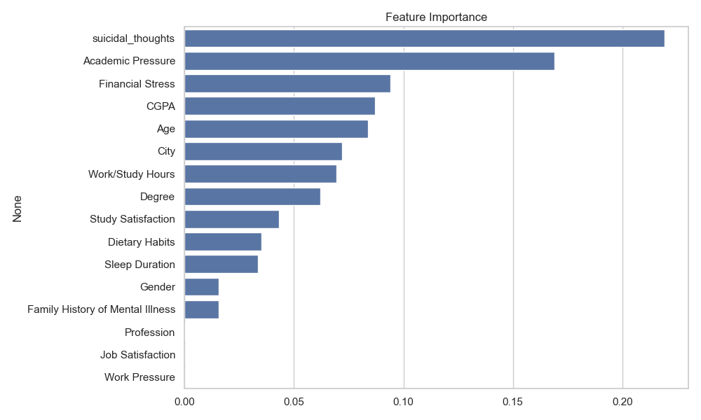

# 🧠 Student Well-being Prediction

A machine learning model and Streamlit app estimating the risk of depression among students from academic, lifestyle and social factors, built as a screening and awareness tool rather than a diagnosis.

## Data

**Student Depression Dataset (Kaggle)**: ~27,900 students, 16 features: academic and work pressure, study satisfaction, sleep duration, dietary habits, study hours, financial stress, family history, etc.

## Method

1. **Cleaning**: text-to-numeric conversion (sleep duration), column renaming
2. **Leakage-safe split** 70 / 15 / 15 (train / validation / test), done **before** encoding
3. **Encoding fitted on the training set only**, with safe handling of unseen categories
4. **Pipeline**: imputation → scaling → Random Forest
5. **Tuning** with `GridSearchCV` (depth, number of trees, split parameters)
6. **Explainability**: feature-importance analysis (`feature_importance.png`)

## Results (test set)

| Metric | Score |
|---|---|
| Accuracy | **0.84** |
| F1 (at-risk class) | **0.87** |
| Recall (at-risk class) | **0.89** |

High recall on the at-risk class was the priority: in a screening context, missing someone who needs support costs more than a false alarm.

<p align="center"></p>

## Run it

```bash
pip install -r requirements.txt
python train.py        # trains the model, saves pipeline.pkl, encoders.pkl, feature_columns.pkl
streamlit run app.py   # launches the app
```

## Tech

Python · Pandas · scikit-learn · Streamlit · Matplotlib · Seaborn

> ⚠️ This tool does not replace a professional assessment. If you are struggling, please reach out to a health professional or someone you trust.

---

**Solange Ilinga** · [LinkedIn](https://linkedin.com/in/solange-ilinga)
